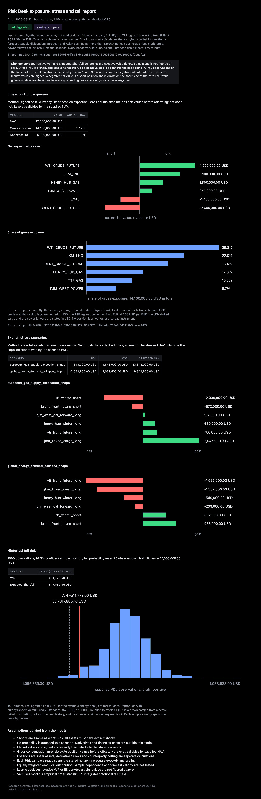
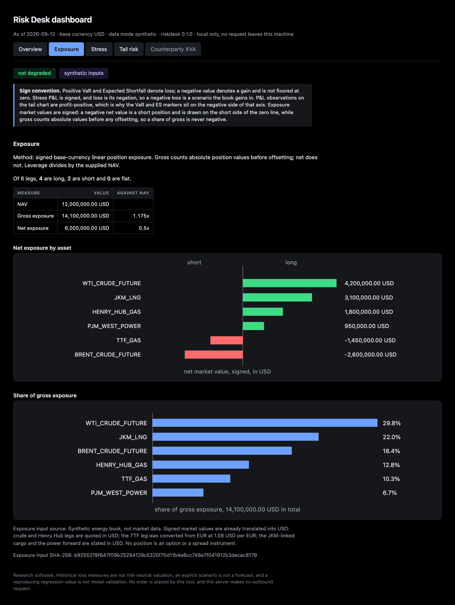

# Risk Desk

Risk Desk is a portfolio risk engine that computes loss measures from
supplied files and reports the method, units and assumptions with every
result. From a P&L sample it computes historical Value at Risk (VaR) and
Expected Shortfall (ES), six model-based estimates of the same two
measures, and four backtests of a forecast record. From signed linear
positions it computes gross and net exposure, stress P&L, Euler risk
attribution, limit grades, a pre-trade what-if and liquidity-adjusted
VaR. For books with European options it computes cash Greeks and full
revaluation through the Option Desk engine. It also computes SA-CCR
exposure at default, portfolio credit VaR and FRTB capital components
from figures the caller supplies. Counterparty exposure and XVA come from
a local Open Source Risk Engine (ORE) project.

The stated limits are part of the output. Scenarios carry no probability,
no horizon is rescaled, and regulatory figures are calculations over
supplied inputs. The software reads no market data and sends no order.

The CLI and 30 local MCP tools call the same runtime functions. An agent
and a person therefore obtain the same numbers, with the same provenance,
units, assumptions and degraded flag attached. A local dashboard shows
the core results in a browser, and 14 plugin skills cover these tasks and
setup.

[](docs/IMPLEMENTATION.md)
[](#evidence)
[](#get-started)
[](LICENSE)

## See the desk



`riskdesk report` writes this page from the synthetic energy book in
`examples/`. The inputs are synthetic examples. They are not market data
and not a record of any position. The page states its sign convention and
prints its degraded flag whether or not the flag is set. It embeds its
own styling and charts, so it opens with no network.

The captures show the dark default. A light mode follows the system
setting of the reader.

### The dashboard


The dashboard serves the same numbers over a loopback socket in five
views, namely overview, exposure, stress, tail risk and counterparty XVA.
The inputs shown are synthetic examples, not market data. The server
binds a loopback address and refuses any other, makes no outbound
request, and reads no path from the request. Every view prints the sign
convention and the degraded flag whether or not the flag is set. A view
whose input was absent states the absence in words that do not imply a
zero.



The exposure view draws the sign convention. The ladder places each of
the 6 legs of the synthetic energy book on the side of the zero line that
its sign gives. A short position is therefore visible without the minus
sign.
The concentration chart is ordered and names the total of which each
share is a part.

## Get started

The requirements are Git and a supported Python. `pyproject.toml`
declares 3.11 or later. The fixed-version dependency set and the ORE
wheel were tested on CPython 3.13, macOS ARM64.

```sh
git clone https://github.com/Iman/agent-driven-risk-desk-and-skills.git
cd agent-driven-risk-desk-and-skills
./install.sh
./demo.sh
```

Then, for the web view:

```sh
.venv/bin/riskdesk dashboard          # http://127.0.0.1:8899
```

`install.sh` creates `.venv`, installs the package with its development
extra, attempts the optional ORE extra, reports the outcome, and runs the
tests. The package needs the Option Desk engine, which pip installs from
PyPI. [INSTALL.md](INSTALL.md) gives the command that checks its hash.
`demo.sh` runs the core commands over the example books and prints the
meaning of each result. The 29 example input files cover every command.
Neither script prints colour, neither reaches the network beyond pip, and
both exit non-zero on any failure.

### Or run it in a container

The container route needs no Python on the host, and the examples are
part of the image.

```sh
docker build -t risk-desk .
docker run --rm --user "$(id -u):$(id -g)" \
    -v "$PWD/artifacts:/artifacts" risk-desk demo
docker run --rm risk-desk                        # what this image can do
```

`--user` is required on Linux. The image runs as a fixed non-root uid,
and a Linux bind mount keeps its host ownership, so without the flag the
container cannot write into the mounted directory. The entrypoint refuses
that case, and each other unusable mount, with its own exit code.
[INSTALL.md](INSTALL.md) lists the codes.

The image contains the core scope. The ORE extra depends on the platform.
On `python:3.13-slim` pip resolves open-source-risk-engine 1.8.16.0 at
linux/amd64 and reports no distribution of any version at linux/arm64.
The build therefore attempts the extra and records the outcome, and
`docker run risk-desk` prints that status. Where the extra is absent,
`xva` is refused before any worker starts. To make a missing extra fail
the build, build with `--build-arg WITH_XVA=require`.

## Ask your agent

### Install the plugin

The runtime is a normal Python install, and the plugin tells an agent
where to find it. Installing the plugin does not install the runtime.
Install the runtime first with `./install.sh`. Then make `riskdesk-mcp`
reachable. Either activate `.venv` in the environment that launches the
agent, or give the client the absolute path of `.venv/bin/riskdesk-mcp`.

| Runtime | Install the plugin | Manifest it reads |
| --- | --- | --- |
| Claude Code | `/plugin marketplace add Iman/agent-driven-risk-desk-and-skills` then `/plugin install risk-desk@risk-desk` | [.claude-plugin/plugin.json](plugins/risk-desk/.claude-plugin/plugin.json), listed in [.claude-plugin/marketplace.json](.claude-plugin/marketplace.json) |
| Codex | Configure the plugin through a Codex marketplace, or add its runtime with `codex mcp add riskdesk -- "$PWD/.venv/bin/riskdesk-mcp"`. Hosted setup is in [OpenAI connections](docs/OPENAI.md). | [.codex-plugin/plugin.json](plugins/risk-desk/.codex-plugin/plugin.json), which points at `skills/` and `.mcp.json` |

Both manifests describe the same plugin and point at the same 14 skill
directories. A validation test fails the build if either stops matching
the directories on disk. [Use the MCP server](#use-the-mcp-server) covers
a client without a plugin and the hosted endpoint.

### Prompts

With the plugin installed, an agent accepts requests such as these.

| Request | Skill | Tool it calls |
| --- | --- | --- |
| "Here is a year of daily P&L in GBP. What is my 99% one-day VaR and Expected Shortfall, and is the sample big enough to say?" | `risk-tail` | `risk_tail` |
| "Take `examples/energy_book.json`. What is my gross and net exposure, my leverage against NAV, and which asset is the biggest share of gross?" | `risk-portfolio` | `risk_exposure` |
| "Apply the two shapes in `examples/energy_stress.json` and tell me the loss, the stressed NAV, and the three positions that hurt most in each." | `risk-stress` | `risk_stress` |
| "Run this ORE project and give me the CVA and DVA. Tell me first whether ORE reported any error and which adjustments were actually enabled." | `risk-xva` | `risk_xva` |
| "Put the historical VaR beside the normal, Student-t, EVT and GARCH estimates for this P&L, and backtest last year's VaR forecasts." | `risk-tail`, `risk-backtest` | `risk_tail_models`, `risk_backtest` |
| "My book holds calls and puts on two futures. What are its cash delta, gamma and vega, and what does a 10% fall with vol up five points do?" | `risk-derivatives` | `risk_derivatives_greeks`, `risk_derivatives_grid` |
| "Which positions drive the VaR, am I inside my limits, and what would selling half the largest leg do to them?" | `risk-attribution`, `risk-limits` | `risk_var_attribution`, `risk_limits`, `risk_what_if` |
| "Replay the 2022 gilt window on my prices, and find the most plausible move that loses 5 million." | `risk-stress` | `risk_stress_replay`, `risk_reverse_stress` |
| "Here is a CSV of my positions with market values in a column called MV. Turn it into a request and tell me what you had to repair." | `risk-data-import` | the tool for that contract |

Each skill states the sign convention and the degraded status before the
numbers, because a loss figure cannot be read without them.

### Commands and agents

The plugin also carries 10 commands and 4 agents. The runtime discovers
them by directory, and the manifest does not declare them.

| Command | Stated before any number |
| --- | --- |
| `/risk-tail` | The observation count, the tail mass and the degraded status |
| `/risk-exposure` | Gross before net, and the largest share of gross |
| `/risk-stress` | The sign convention, and that no probability is attached |
| `/risk-xva` | The ORE error level, and a refusal in place of a quote |
| `/risk-report` | That an absent input is not a measure of zero |
| `/risk-dashboard` | Loopback only, and the meaning of each refusal code |
| `/risk-backtest` | Exceptions against expected, and that a high p-value is not proof |
| `/risk-limits` | Breaches first, and that not evaluated is not within |
| `/risk-whatif` | Before beside after, and that no trade is placed |
| `/risk-daily` | Every degraded result and breach, and which inputs were synthetic |

The agents have these tasks.

- `risk-data-auditor` checks whether the inputs support any conclusion.
- `risk-reviewer` tests whether a number can be trusted, as distinct from
  whether its arithmetic is right.
- `risk-model-validator` derives a model result again, backtests it and
  compares challenger models.
- `stress-scenario-designer` builds historical, hypothetical and reverse
  scenarios from the data of the caller and the dated library.

The reviewer and the validator must state when they find no reason to
doubt a result.

### Read it in a browser

`riskdesk dashboard` serves the synthetic energy book by default, from
`examples/`. It takes the same `--input`, `--tail`, `--exposure` and
`--xva` flags as `riskdesk report`. It computes nothing of its own. The
views come from the functions that the CLI and the MCP tools call,
through the same shaping path as the saved report page. A test compares
the two payloads field by field.

The dashboard serves one machine. It has no authentication, so it binds a
loopback address and refuses any other host. Each failure has its own
exit code and one sentence on stderr. The codes are 64 for a host that is
not loopback, 66 for a missing input, 67 for an input that fails its
contract, and 73 for a port already in use.

The XVA view never runs ORE. The adapter needs a trusted local project
directory, a new output directory and a separate process. The view
therefore reprints a result that the adapter already wrote, or states
what is missing.

### Use it from LangChain or LangGraph

[agent/](agent/pyproject.toml) is a separate package, `riskdesk-agent`
0.2.0, the Risk Desk port of the Option Desk agent layer. It is not a
dependency of `riskdesk`.

```sh
python -m pip install -e ./agent
python -m pip install "langgraph==1.2.19"   # only for the graph
```

- `desk_tools()` turns the tools that `riskdesk-mcp` registers into
  LangChain tools. Names, descriptions and input schemas are read from
  the server, and every call passes through the validation of the server,
  so no second tool list exists.
- `ask(question, model=...)` runs a three-node LangGraph routine. The
  model selects read-only tools, the tools run, and the model answers
  under the reporting rules that `risk_desk_status` returns. A tool call
  with a number that the question does not contain is refused before it
  runs. An answer with a number that is in no tool result is withheld,
  and the tool results are returned in its place.

The tested versions are `langchain-core==1.7.2` and `langgraph==1.2.19`.
[agent/wheel-hashes.json](agent/wheel-hashes.json) records every wheel
installed for them on CPython 3.13 and macOS ARM64, with its sha256. They
install on top of the Risk Desk wheels without changing any of them. The
tests use a scripted chat model and need no network and no API key.

## Use the MCP server

The same tools are available from a local stdio server and from a hosted
endpoint. The local and the hosted plugin expose tools with the same
names, so install one of them in a session and not both.

### Local server

`riskdesk-mcp` is a stdio server with 30 tools. It binds no socket and
makes no market-data or broker request. It needs the runtime, which
`./install.sh` installs. Installing a plugin does not install the
runtime. Register the server with a client in one of these ways.

```sh
claude mcp add riskdesk -- "$PWD/.venv/bin/riskdesk-mcp"   # Claude Code
codex mcp add riskdesk -- "$PWD/.venv/bin/riskdesk-mcp"    # Codex
```

Any other MCP client takes the entry in
[plugins/risk-desk/.mcp.json](plugins/risk-desk/.mcp.json).

```json
{
  "mcpServers": {
    "riskdesk": {
      "type": "stdio",
      "command": "riskdesk-mcp",
      "args": []
    }
  }
}
```

If the client does not inherit the environment in which `.venv` is
active, replace `riskdesk-mcp` with the absolute path of
`.venv/bin/riskdesk-mcp`.

### Hosted endpoint

The endpoint is live at `https://riskdesk.avidquant.com/mcp`. It uses
Streamable HTTP and needs no sign-in. It serves 29 tools, namely every
local tool except `risk_xva`, and all of them are read-only. A
calculation tool called without a `request` runs on a shipped synthetic
example. A call with supplied data needs a `request` object and
`rights_confirmed=true`, which is set only after the user confirms
permission for hosted processing. For real positions the local server is
the better choice, because it computes locally and sends nothing
anywhere. [PRIVACY.md](PRIVACY.md) links the hosted privacy policy.

| Client | Connection |
| --- | --- |
| Claude Code, server only | `claude mcp add --transport http riskdesk-hosted https://riskdesk.avidquant.com/mcp` |
| Claude Code, plugin with skills | `/plugin marketplace add Iman/agent-driven-risk-desk-and-skills` then `/plugin install risk-desk-hosted@risk-desk` |
| Claude chat | In Settings, open Connectors, select Add custom connector and paste the endpoint URL |
| Codex and ChatGPT | [docs/OPENAI.md](docs/OPENAI.md) |
| Any MCP client | The entry below, from [plugins/risk-desk-hosted/.mcp.json](plugins/risk-desk-hosted/.mcp.json) |

```json
{
  "mcpServers": {
    "riskdesk-hosted": {
      "type": "http",
      "url": "https://riskdesk.avidquant.com/mcp"
    }
  }
}
```

### Tools

`src/riskdesk/server.py` registers the tools, and
`python scripts/list_tools.py` prints them. Call `risk_desk_status`
first.

| Area | Tool | Purpose |
| --- | --- | --- |
| Status | `risk_desk_status` | Runtime version, tool list, accepted data modes and reporting conventions |
| Tail risk and backtests | `risk_tail` | Historical VaR and ES on supplied horizon P&L |
| | `risk_tail_models` | VaR and ES under historical, normal, Student-t, EVT and three GARCH methods |
| | `risk_backtest` | Kupiec, Christoffersen, Basel zone and $Z_2$ tests of a VaR and optional ES series |
| Exposure and derivatives | `risk_exposure` | Gross and net exposure and concentration of signed linear positions |
| | `risk_derivatives_greeks` | Cash delta, gamma, vega, theta and rho of linear positions and European options |
| | `risk_derivatives_grid` | Full revaluation over a spot and vol shock grid, against delta-gamma-vega |
| | `risk_derivatives_historical` | Historical full-revaluation P&L, VaR and ES of an options book |
| Attribution and limits | `risk_covariance` | Sample, EWMA or Ledoit-Wolf covariance, volatility and correlation |
| | `risk_var_attribution` | Parametric normal VaR and ES with Euler contributions and incremental VaR |
| | `risk_es_attribution` | Historical-simulation ES with Euler contributions per position |
| | `risk_factor_exposure` | Factor betas and the systematic and idiosyncratic variance split |
| | `risk_limits` | Grades of a limit set against exposure, tail and stress results |
| | `risk_what_if` | Exposure, stress, tail and limit grades after proposed trades |
| Liquidity | `risk_liquidity` | Days to liquidate, holdings by day, spread cost and liquidity-adjusted VaR |
| Stress and scenarios | `risk_stress` | Explicit asset shocks applied to all linear positions, with no probability |
| | `risk_stress_replay` | Replay of a dated historical window from the price levels of the caller |
| | `risk_scenario_library` | The dated historical windows with sources, as dates only |
| | `risk_reverse_stress` | The most plausible shock under a supplied covariance for a target loss |
| | `risk_scenario_scale` | A scenario scaled so that the book loses a target amount |
| Counterparty and credit | `risk_saccr` | SA-CCR exposure at default for one netting set, with every intermediate figure |
| | `risk_exposure_profile` | Peak PFE, EPE, Effective EE and Effective EPE from a simulated exposure profile |
| | `risk_credit_asrf` | Vasicek ASRF credit VaR, expected and unexpected loss |
| | `risk_credit_copula` | Seeded one-factor Gaussian copula credit VaR and ES |
| | `risk_xva` | Run of a trusted local ORE project in a worker. Local only, and the one tool that is not read-only |
| FRTB | `risk_frtb_imcc` | Liquidity-adjusted, stress-scaled ES and IMCC from supplied ES figures |
| | `risk_frtb_ima_capital` | IMA aggregate capital, multiplier, amber-desk surcharge and RWA |
| | `risk_frtb_pla` | P&L attribution test metrics and the desk zone |
| | `risk_frtb_backtest` | Exception counts at 97.5% and 99%, with the desk verdict or the bank zone |
| | `risk_frtb_sbm_fx` | Standardised sensitivities-based FX delta and vega capital |

These requests use the tools directly.

- "Check Risk Desk status, then explain the synthetic energy book's tail
  risk. State the currency, horizon, loss signs and degraded status
  first."
- "Take `examples/energy_book.json`. What is my gross and net exposure,
  my leverage against NAV, and which asset is the biggest share of
  gross?"
- "Replay the 2022 gilt window on my prices, and find the most plausible
  move that loses 5 million."

## Methods

The table names each model and statistic, the formula the code computes,
the module that computes it and the reference the repository cites.
[docs/models/INVENTORY.md](docs/models/INVENTORY.md) holds the complete
inventory of 29 models with their validation status, and
[docs/models/ASSUMPTIONS.md](docs/models/ASSUMPTIONS.md) holds the
assumptions register. The skill reference files under
[plugins/risk-desk/skills](plugins/risk-desk/skills) give the full
derivations and bibliographic records.

Notation. $x_t$ is a P&L observation and $V$ the portfolio value, so the
loss is $L_t = -x_t / V$. $q$ is the confidence level, a request
parameter. $L_{(1)} \ge \dots \ge L_{(n)}$ are the ordered losses,
$m = n(1-q)$ is the tail mass and $k = \lceil m \rceil$. $\Phi$ and
$\varphi$ are the standard normal distribution and density, and
$z_q = \Phi^{-1}(q)$. A positive VaR or ES is a loss, a negative value is
a gain, and neither is floored at zero.

| Model | Formula | Source module | Reference |
| --- | --- | --- | --- |
| Historical VaR and ES | Eq. (1), empirical order statistic and fractional tail mass | `src/riskdesk/analytics.py` `tail_risk` | skfolio `value_at_risk` and `cvar` |
| Normal VaR and ES | Eq. (2), maximum likelihood fit to the losses | `src/riskdesk/tail_models.py` `_normal` | none cited |
| Student-t VaR and ES | Eq. (3), maximum likelihood location-scale fit | `src/riskdesk/tail_models.py` `_student_t` | none cited |
| EVT peaks over threshold | Eq. (4), generalised Pareto fit to the $\lfloor 0.10\,n \rfloor$ largest losses | `src/riskdesk/tail_models.py` `_pot` | McNeil and Frey (2000), eq. (9), (10) and (14), read from the preprint of the authors |
| GARCH(1,1)-t filtered historical, GARCH-EVT and Monte Carlo | Eq. (5), with Eq. (1) or Eq. (4) applied to the filtered series | `src/riskdesk/tail_models.py` `tail_models` | Option Desk `fit_garch_t` and `simulate_paths`. GARCH-EVT follows McNeil and Frey (2000), eq. (3), with a Bayesian fit. Filtered historical simulation has none cited |
| Kupiec proportion of failures | Eq. (6), $\chi^2_1$ p-value | `src/riskdesk/backtest.py` `_kupiec` | Kupiec (1995), bibliographic record only, the paper text was not read |
| Christoffersen independence and conditional coverage | Eq. (7), $\chi^2_1$ and $\chi^2_2$ p-values | `src/riskdesk/backtest.py` `_christoffersen` | Christoffersen (1998), bibliographic record only, the paper text was not read |
| Basel traffic light | Eq. (8), reported at $q = 0.99$ and a one-day horizon only | `src/riskdesk/backtest.py` `_basel_zone` | Basel Framework MAR99.17 and Table 2, as transcribed by the engineers |
| Acerbi-Szekely $Z_2$ | Eq. (9), p-value simulated under a stated null | `src/riskdesk/backtest.py` `_z2`, `_es_test` | MathWorks documentation of `esbacktestbysim`, which cites Acerbi and Szekely (2014). The paper text was not read |
| Covariance, sample, EWMA and Ledoit-Wolf | Eq. (10) | `src/riskdesk/decomposition.py` `covariance_estimate` | RiskMetrics Technical Document (1996) for EWMA, Ledoit and Wolf (2004) through scikit-learn. The sample estimator has none cited |
| Parametric VaR and ES with Euler allocation | Eq. (11) | `src/riskdesk/decomposition.py` `parametric_var` | Tasche (2008), eq. (2.6), (2.10), (3.4a) and (3.10a) |
| Historical ES with Euler allocation | Eq. (12) | `src/riskdesk/decomposition.py` `historical_es` | Tasche (2008), eq. (3.11a) and section 3.4 |
| Factor exposure and variance split | Ordinary least squares with an intercept, and in sample total variance equals systematic plus idiosyncratic | `src/riskdesk/decomposition.py` `factor_exposure` | none cited |
| Liquidation horizon and liquidity-adjusted VaR | Eq. (13) | `src/riskdesk/liquidity.py` `liquidity_risk` | Bangia, Diebold, Schuermann and Stroughair (1999), eq. (4), for the cost. The additive sum is confirmed only from a secondary source, Qi and Ng (2009) |
| Reverse stress | Eq. (14), minimum Mahalanobis distance | `src/riskdesk/scenarios.py` `reverse_stress` | none cited. The derivation is in the `risk-stress` reference |
| Option value and cash Greeks | Eq. (15), Black-Scholes-Merton for spot and Black-76 for futures | `src/riskdesk/derivatives.py` `book_greeks` | Black and Scholes (1973), Merton (1973), Black (1976). Bibliographic records were checked and the texts were not read |
| SA-CCR exposure at default | Eq. (16) | `src/riskdesk/counterparty.py` `saccr_ead` | Basel Framework CRE52 and CRE99, BCBS 279 Annex 4a |
| Exposure profile, EPE and Effective EPE | Eq. (17) | `src/riskdesk/counterparty.py` `exposure_profile_summary` | Basel Framework CRE50.27 to CRE50.31 and CRE53.12 to CRE53.13 |
| Vasicek ASRF credit VaR | Eq. (18) | `src/riskdesk/credit.py` `asrf_credit_var` | Basel Framework CRE31.5 and CRE99 Table 1 |
| One-factor Gaussian copula credit VaR | Eq. (19), then Eq. (1) on the simulated losses | `src/riskdesk/credit.py` `copula_credit_var` | none cited |
| FRTB IMA liquidity-adjusted ES and IMCC | Eq. (20) | `src/riskdesk/frtb.py` `frtb_imcc` | Basel Framework MAR33.4, MAR33.6 and MAR33.15 |
| FRTB IMA capital aggregation | Eq. (21) | `src/riskdesk/frtb.py` `frtb_ima_capital` | Basel Framework MAR33.41 to MAR33.46 and MAR32.9 Table 1 |
| FRTB P&L attribution test | Eq. (22) | `src/riskdesk/frtb.py` `frtb_pla` | Basel Framework MAR32.34 to MAR32.42 |
| FRTB backtesting exception count | Eq. (23) | `src/riskdesk/frtb.py` `frtb_backtest` | Basel Framework MAR32.3 to MAR32.19 |
| FRTB sensitivities-based method, FX delta and vega | Eq. (24) | `src/riskdesk/frtb.py` `frtb_sbm_fx` | Basel Framework MAR21.4 to MAR21.7 and MAR21.86 to MAR21.95 |

Exposure, linear stress, limit checks, the pre-trade what-if, historical
replay and scenario scaling are sums, products and comparisons of the
supplied values. The inventory lists them as M02, M03, M13, M14, M16 and
M19. The ORE adapter (M29) passes a local project to an external engine
and computes no figure of its own.

**(1) Historical VaR and ES.** The backend is skfolio. Where $m$ is an
exact integer, the confidence passed to the backend moves one float
towards 1 so that binary rounding cannot select the next order statistic.

$$\mathrm{VaR}_q = V\,L_{(k)}, \qquad \mathrm{ES}_q = \frac{V}{m}\left[\sum_{i=1}^{k-1} L_{(i)} + \bigl(m-(k-1)\bigr)\,L_{(k)}\right]$$

**(2) Normal.** $\hat\mu$ and $\hat\sigma$ are the maximum likelihood
mean and standard deviation of the losses.

$$\mathrm{VaR}_q = V\left(\hat\mu + \hat\sigma z_q\right), \qquad \mathrm{ES}_q = V\left(\hat\mu + \hat\sigma\,\frac{\varphi(z_q)}{1-q}\right)$$

**(3) Student-t.** $\nu$, $\hat\mu$ and $s$ are the fitted degrees of
freedom, location and scale, $g_\nu$ is the standard t density and
$x = t_\nu^{-1}(q)$. ES is not reported for $\nu \le 1$.

$$\mathrm{VaR}_q = V\left(\hat\mu + s\,x\right), \qquad \mathrm{ES}_q = V\left(\hat\mu + s\,\frac{g_\nu(x)}{1-q}\,\frac{\nu + x^2}{\nu - 1}\right)$$

**(4) EVT peaks over threshold.** $k_u = \lfloor 0.10\,n \rfloor$, the
threshold $u$ is the $(k_u+1)$th largest loss, and $\xi$ and $\beta$ are
the fitted shape and scale of the excesses. The estimate needs
$q > 1 - k_u/n$, and ES is not reported for $\xi \ge 1$. Fewer than 50
exceedances set the degraded flag.

$$\mathrm{VaR}_q = V\left(u + \frac{\beta}{\xi}\left[\left(\frac{1-q}{k_u/n}\right)^{-\xi} - 1\right]\right), \qquad \mathrm{ES}_q = \frac{\mathrm{VaR}_q + V(\beta - \xi u)}{1-\xi}$$

**(5) GARCH(1,1)-t.** The parameters are the posterior means of the
Bayesian fit in the Option Desk engine, on $r_t = x_t / V$.

$$\sigma_{t+1}^2 = \omega + \alpha\,(r_t - \mu)^2 + \beta\,\sigma_t^2, \qquad \sigma_1^2 = \frac{\omega}{1-\alpha-\beta}, \qquad z_t = \frac{r_t - \mu}{\sigma_t}$$

Filtered historical simulation applies Eq. (1) to the series
$\mu + \sigma_{T+1} z_t$. GARCH-EVT applies Eq. (4) to the residual
losses $-z_t$ and reports $V(-\mu + \sigma_{T+1}\mathrm{VaR}_z)$, with ES
scaled in the same way. The Monte Carlo column applies Eq. (1) to
one-step simulated returns, and each path draws its own posterior
parameter set.

**(6) Kupiec.** An exception is a realised loss strictly greater than the
VaR forecast of that day. With $x$ exceptions in $n$ days, $p = 1 - q$
and $\hat p = x/n$,

$$\mathrm{LR}_{\mathrm{pof}} = -2\left[(n-x)\ln\frac{1-p}{1-\hat p} + x\ln\frac{p}{\hat p}\right]$$

**(7) Christoffersen.** $n_{ij}$ counts the transitions from state $i$ to
state $j$ of the exception indicator, $\pi_0 = n_{01}/(n_{00}+n_{01})$,
$\pi_1 = n_{11}/(n_{10}+n_{11})$ and $\pi = (n_{01}+n_{11})/(n-1)$. With
$\ell(a,b) = n_{00}\ln(1-a) + n_{01}\ln a + n_{10}\ln(1-b) + n_{11}\ln b$,

$$\mathrm{LR}_{\mathrm{ind}} = -2\left[\ell(\pi,\pi) - \ell(\pi_0,\pi_1)\right], \qquad \mathrm{LR}_{\mathrm{cc}} = -2\left[\ell(p,p) - \ell(\pi_0,\pi_1)\right]$$

**(8) Basel traffic light.** The zone follows the cumulative binomial
probability of the observed count, computed for the number of rows
supplied.

$$F = \Pr\left[\mathrm{Bin}(n,\,0.01) \le x\right], \qquad \text{amber if } F \ge 0.95, \qquad \text{red if } F \ge 0.9999$$

**(9) Acerbi-Szekely $Z_2$.** $X_t$ is the realised P&L, $\alpha = 1-q$
and $I_t = 1$ when $X_t + \mathrm{VaR}_t < 0$. The p-value comes from
10,000 seeded simulations under a location-scale normal or Student-t null
whose VaR and ES equal the forecasts of each day.

$$Z_2 = \sum_{t=1}^{T} \frac{X_t I_t}{T\,\alpha\,\mathrm{ES}_t} + 1$$

**(10) Covariance.** $r_t$ is the return row at time $t$ of $T$, and
$\lambda$ is the decay parameter. The Ledoit-Wolf estimator shrinks the
maximum likelihood estimate towards a scaled identity. A matrix that is
not positive definite is returned unaltered with the degraded flag set.

$$S = \frac{1}{T-1}\sum_{t=1}^{T}(r_t - \bar r)(r_t - \bar r)^{\top}, \qquad \Sigma_{\mathrm{EWMA}} = \sum_{t=1}^{T} w_t\,r_t r_t^{\top}, \quad w_t = \frac{\lambda^{T-t}}{\sum_{s=1}^{T}\lambda^{T-s}}$$

**(11) Parametric VaR and ES with Euler allocation.** $e$ is the vector
of net exposure per asset, $x_j$ the market value of position $j$ and
$a(j)$ its asset. The constant $c$ is $z_q$ for VaR and
$\varphi(z_q)/(1-q)$ for ES.

$$\sigma = \sqrt{e^{\top}\Sigma e}, \qquad \mathrm{VaR}_q = z_q\,\sigma, \qquad \mathrm{ES}_q = \frac{\varphi(z_q)}{1-q}\,\sigma, \qquad \mathrm{component}_j = x_j\,\frac{c\,(\Sigma e)_{a(j)}}{\sigma}$$

The components sum to the total. Incremental VaR is the VaR of the book
minus the VaR of the book without position $j$, with the variance
computed again in full.

**(12) Historical ES with Euler allocation.** $L_{j,(t)}$ is the loss of
position $j$ in the scenario ranked $t$ by portfolio loss, and $w_t$ is 1
for the first $\lfloor m \rfloor$ scenarios and $m - \lfloor m \rfloor$
for the next.

$$\mathrm{ES}_q = \frac{1}{m}\sum_{t} w_t\,L_{(t)}, \qquad \mathrm{component}_j = \frac{1}{m}\sum_{t} w_t\,L_{j,(t)}$$

**(13) Liquidity.** $G_a$ is the gross value held in asset $a$, $\rho$
the participation rate, $\mathrm{ADV}_a$ the average daily traded value,
$\bar s_a$ and $\sigma_{s,a}$ the mean and volatility of the relative
spread, and $\kappa$ the spread multiplier supplied by the caller. VaR is
Eq. (1) on the supplied P&L, and no term is rescaled to the liquidation
period.

$$\mathrm{days}_a = \frac{G_a}{\rho\,\mathrm{ADV}_a}, \qquad \mathrm{COL}_a = \tfrac{1}{2}\,G_a\left(\bar s_a + \kappa\,\sigma_{s,a}\right), \qquad \mathrm{LVaR} = \mathrm{VaR}_q + \sum_a \mathrm{COL}_a$$

**(14) Reverse stress.** $w$ is the net market value per asset, $\Sigma$
the supplied covariance of returns and $\mathcal{L}$ the target loss. The
shock $s$ minimises $s^{\top}\Sigma^{-1}s$ subject to
$w^{\top}s = -\mathcal{L}$. Where the closed form breaches a floor, the
bounded problem is solved numerically with SLSQP.

$$s^{\ast} = -\mathcal{L}\,\frac{\Sigma w}{w^{\top}\Sigma w}, \qquad d^{\ast} = \frac{\mathcal{L}}{\sqrt{w^{\top}\Sigma w}}$$

**(15) Cash Greeks.** $\Delta$, $\Gamma$, $\mathcal{V}$ and $\varrho$ are
the engine Greeks of an underlying with price $S$, netted over quantity
times multiplier. Theta is per calendar day. Black-76 rho is $-t$ times the option value,
with the future held fixed.

$$\text{cash delta} = \Delta S, \qquad \text{cash gamma per 1 percent} = \frac{\Gamma S^2}{100}, \qquad \text{vega per point} = \frac{\mathcal{V}}{100}, \qquad \text{rho per point} = \frac{\varrho}{100}$$

**(16) SA-CCR.** $V$ is the netting set value, $C$ the haircut value of
net collateral, and the aggregate add-on sums the asset class add-ons
built from effective notionals $D = d \cdot \mathrm{MF} \cdot \delta$.
For a margined set RC is
$\max(V - C,\ \mathrm{TH} + \mathrm{MTA} - \mathrm{NICA},\ 0)$, and the
EAD is capped at the unmargined EAD of the same set.

$$\mathrm{EAD} = 1.4\,(\mathrm{RC} + \mathrm{PFE}), \qquad \mathrm{RC} = \max(V - C,\ 0), \qquad \mathrm{PFE} = \min\left(1,\ 0.05 + 0.95\exp\left(\frac{V - C}{1.9\,\mathrm{AddOn}}\right)\right)\mathrm{AddOn}$$

**(17) Exposure profile.** $\mathrm{EE}_k$ is the expected exposure that
ORE reports at date $t_k$, $\Delta t_k = t_k - t_{k-1}$, and the sums run
over the dates up to one year, with $H$ the horizon covered.

$$\mathrm{EEE}_k = \max(\mathrm{EEE}_{k-1},\ \mathrm{EE}_k), \qquad \mathrm{EPE} = \frac{1}{H}\sum_k \mathrm{EE}_k\,\Delta t_k, \qquad \mathrm{EEPE} = \frac{1}{H}\sum_k \mathrm{EEE}_k\,\Delta t_k$$

**(18) Vasicek ASRF.** $\mathrm{PD}_i$, $\mathrm{LGD}_i$ and the asset
correlation $R_i$ are caller inputs. Unexpected loss is credit VaR minus
$\sum_i \mathrm{EAD}_i\,\mathrm{LGD}_i\,\mathrm{PD}_i$. No maturity
adjustment is applied.

$$\mathrm{VaR}_q = \sum_i \mathrm{EAD}_i\,\mathrm{LGD}_i\,\Phi\left(\frac{\Phi^{-1}(\mathrm{PD}_i) + \sqrt{R_i}\,\Phi^{-1}(q)}{\sqrt{1-R_i}}\right)$$

**(19) One-factor Gaussian copula.** $Z$ and $\varepsilon_i$ are
independent standard normal draws and $a_i$ is the factor loading. VaR
and ES are Eq. (1) applied to the seeded simulated losses.

$$\text{obligor } i \text{ defaults when } a_i Z + \sqrt{1-a_i^2}\,\varepsilon_i < \Phi^{-1}(\mathrm{PD}_i), \qquad \mathrm{loss} = \sum_{i\ \mathrm{defaulted}} \mathrm{EAD}_i\,\mathrm{LGD}_i$$

**(20) FRTB liquidity-adjusted ES and IMCC.** The caller supplies the
10-day ES of each liquidity-horizon subset. $T = 10$ and
the liquidity horizons $\mathrm{LH}_j$ are 10, 20, 40, 60 and 120 days. The subscripts R and F
denote the reduced and the full set of risk factors, and S and C the
stressed and the current period.

$$\mathrm{ES} = \sqrt{\mathrm{ES}_T(P)^2 + \sum_{j \ge 2}\left(\mathrm{ES}_T(P,j)\sqrt{\frac{\mathrm{LH}_j - \mathrm{LH}_{j-1}}{T}}\right)^2}$$

$$\mathrm{IMCC}(C) = \mathrm{ES}_{R,S}\,\max\left(1,\ \frac{\mathrm{ES}_{F,C}}{\mathrm{ES}_{R,C}}\right), \qquad \mathrm{IMCC} = 0.5\,\mathrm{IMCC}(C) + 0.5\sum_i \mathrm{IMCC}(C_i)$$

**(21) FRTB IMA capital.** $m_c$ is the MAR32.9 multiplier for the
bank-wide exception count plus the qualitative add-on. All inputs are
supplied figures. $\mathrm{SA}_U$ is the standardised charge of
out-of-scope desks and $k = 0.5\,\sum \mathrm{SA}_{\mathrm{amber}} / \sum \mathrm{SA}$.

$$C_A = \max\left(\mathrm{IMCC}_{t-1} + \mathrm{SES}_{t-1},\ m_c\,\overline{\mathrm{IMCC}} + \overline{\mathrm{SES}}\right), \qquad \mathrm{IMA}_{G,A} = C_A + \max\left(\overline{\mathrm{DRC}},\ \mathrm{DRC}_{t-1}\right)$$

$$\mathrm{ACR} = \min\left(\mathrm{IMA}_{G,A} + k\,\max(0,\ \mathrm{SA}_{G,A} - \mathrm{IMA}_{G,A}) + \mathrm{SA}_U,\ \mathrm{SA}_{\mathrm{all}}\right) + \max\left(0,\ \mathrm{IMA}_{G,A} - \mathrm{SA}_{G,A}\right), \qquad \mathrm{RWA} = 12.5\,\mathrm{ACR}$$

**(22) FRTB P&L attribution.** $\rho_S$ is the Spearman correlation, with
average ranks for ties, and $D$ the Kolmogorov-Smirnov distance between
250 observations of risk-theoretical and hypothetical P&L.

$$\text{green if } \rho_S > 0.80 \text{ and } D < 0.09, \qquad \text{red if } \rho_S < 0.70 \text{ or } D > 0.12, \qquad \text{amber otherwise}$$

**(23) FRTB backtesting.** $P_t$ is the actual or the hypothetical P&L. A
day with a missing P&L or VaR counts as an exception, and the greater of
the two counts is used. A desk passes with at most 12 exceptions at 99%
and at most 30 at 97.5%.

$$N = \left\lvert \lbrace t : -P_t > \mathrm{VaR}_t \rbrace \right\rvert, \qquad N_{\mathrm{overall}} = \max\left(N_{\mathrm{APL}},\ N_{\mathrm{HPL}}\right)$$

**(24) FRTB FX sensitivities-based method.** $\mathrm{WS}_k$ is a net
sensitivity times its risk weight, $S_b$ the sum of the weighted
sensitivities in bucket $b$, and $\gamma = 0.60$. The delta risk weight
is 15%, divided by $\sqrt{2}$ for specified pairs when elected, and the
vega risk weight is 100%. The capital is the largest total over the low,
medium and high correlation scenarios of MAR21.6. Where the sum under
the second root is negative, the alternative of MAR21.4(5)(b) applies.
Curvature is not computed.

$$K_b = \sqrt{\max\left(0,\ \sum_k \mathrm{WS}_k^2 + \sum_{k \ne l}\rho_{kl}\,\mathrm{WS}_k \mathrm{WS}_l\right)}, \qquad \mathrm{charge} = \sqrt{\sum_b K_b^2 + \sum_{b \ne c}\gamma\,S_b S_c}$$

The input contracts are in
[plugins/risk-desk/references/contracts.md](plugins/risk-desk/references/contracts.md).
The Pydantic models in `src/riskdesk/models.py` and in each calculation
module are the executable version. Unknown fields and non-finite numbers
are rejected. Every core result carries provenance, a SHA-256 of its
input, its currency, its assumptions and a degraded flag.

The ORE adapter preserves upstream column names, currency, requested
adjustment flags and unavailable values. Netting-set and trade rows
overlap, so they are never summed, and a zero in a disabled column is not
a result. [docs/ORE.md](docs/ORE.md) gives the fixed-version
reproduction, what it does and does not establish, and the rules for
running another project. Version 1.8.16.0 was tested on CPython 3.13,
macOS ARM64. On other platforms, install `.` without the extra.

## Design rationale

| Choice | Alternative replaced | Reason with evidence |
| --- | --- | --- |
| The tail mass is computed in decimal arithmetic, and at an exact integer the backend confidence moves one float towards 1 | Passing the confidence to skfolio unchanged | For P&L of -20 to -1 at 95%, the unadjusted backend returned VaR 19 where the order statistic is 20 (docs/IMPLEMENTATION.md, observation of 13 September 2026). `tests/test_risk.py` holds the case, and ASSUMPTIONS.md records the choice as I10 |
| Each P&L observation spans the stated horizon | Square-root-of-time scaling of a shorter horizon | The dependence of the sample is not tested, so a scaled figure would rest on an unchecked assumption. Every tail result returns this statement in its `assumptions` list |
| A covariance matrix that is not positive definite is returned unaltered with the degraded flag | Eigenvalue clipping or a positive floor | Clipping to zero leaves the matrix singular, and a positive floor is an invented constant, as the `risk-attribution` reference records |
| The $Z_2$ p-value is simulated under a stated location-scale null | Fixed zone cut-offs attributed to the paper by secondary sources | The paper text was not read, so the cut-offs are not used (ASSUMPTIONS.md I12). An independent 20,000-draw simulation reproduces the p-value within four standard errors (I08) |
| The coverage gate is measured from the unit suite alone | Coverage of the whole test run | Integration tests execute lines about which they assert nothing. `scripts/check_unit_coverage.py` sets the minimum at 80 percent and refuses a report that is missing a production file |
| The dashboard binds a loopback address only | A configurable bind host | The dashboard has no authentication. `0.0.0.0`, `::`, a routable address and a host name were each refused with exit 64 before a socket existed, as docs/IMPLEMENTATION.md records for 15 September 2026 |

## Evidence

| Item | Recorded value | Source |
| --- | --- | --- |
| Tests collected | 818 | `python -m pytest --collect-only -q`, recorded in `docs/evidence.json` |
| Unit line coverage of `src/riskdesk` | 93.78 percent from 677 passing unit tests, against a gate of 80 percent | [docs/IMPLEMENTATION.md](docs/IMPLEMENTATION.md), audit of 6 November 2026 |
| Independent numerical review | 186 checks in nine areas, 0 failures | [research/math-review](research/math-review/README.md), `manifest.json` of 6 November 2026 |
| Model inventory | 29 models, of which 19 verified, 9 partially verified and 1 not validated | [docs/models/INVENTORY.md](docs/models/INVENTORY.md) |
| Assumptions register | 116 assumptions returned by the functions and 25 recorded interpretations | [docs/models/ASSUMPTIONS.md](docs/models/ASSUMPTIONS.md) |
| Mutation run over the analytics | 33 mutations, 31 detected by the test file named for each, 2 recorded as equivalent, 0 survivors | `scripts/mutate.py`, last recorded run |
| Documented figures | 20 figures checked, 0 problems | `scripts/evidence.py check` |

The review recomputes each result from first principles and calls the
module only to compare. Verified means that the code computes the stated
formula. It does not mean that a model is fit for a given portfolio,
calibrated, or approved by a supervisor. The review re-read CRE99 Table 1
only, and every other transcription of a regulatory constant is recorded
as unproven in the inventory.

Three gates keep the record current.

- `tests/test_governance.py` fails when a model module has no inventory
  row, or when a reviewed module differs from the sha256 in the review
  manifest.
- `scripts/evidence.py check` fails when a document and
  `docs/evidence.json` disagree about a quoted figure. A validation test
  runs that check.
- `scripts/check_unit_coverage.py` fails when unit coverage falls below
  the gate.

Figures counted in this checkout are marked `measured` in
`docs/evidence.json`. The ORE regression values came from a run against
an upstream checkout that is not part of this repository. They carry a separate
mark there, with the date of the observation. The two mutants recorded as
equivalent are not killed, so the repository carries no mutation badge.

## Limitations

Risk Desk is research software. It reads the files it is given, writes
files, and places no orders. It opens no broker connection and fetches no
market data.

- It does not establish regulatory compliance, forecast skill,
  wrong-way-risk calibration, liquidity survival, SIMM permissions, or
  coverage of every instrument that ORE supports.
- An SA-CCR or FRTB figure is a calculation over supplied inputs and is
  not a regulatory submission. The SA-CCR FX and equity add-ons are
  partially verified, because the Basel Framework publishes no worked
  example for them.
- A historical loss measure is not a risk-neutral valuation, and a
  regression value that reproduces is not model validation.
- A scenario carries no probability. Every scenario must give an explicit
  return shock for every asset.
- No square-root-of-time scaling is applied and no observation is
  dropped. Each P&L observation must already span the stated horizon.
- Exposure, stress and the linear tools take signed linear positions in
  one base currency and refuse options. `risk_derivatives_*` covers
  European calls and puts only. American and exotic options, implied
  volatility solving, nonlinear margin and credit migration need a
  configured valuation model that this project does not provide.
- A small tail sample sets the degraded flag. The flag is a reporting
  threshold. It is not a confidence interval and not forecast validation.

## Where the desk is listed

| Listing | Entry | Status |
| --- | --- | --- |
| [Official MCP Registry](https://registry.modelcontextprotocol.io/v0/servers?search=com.avidquant/riskdesk) | `com.avidquant/riskdesk`, version 0.2.0, with a remote entry for `https://riskdesk.avidquant.com/mcp` | Published 10 November 2026 |
| Hosted service | [riskdesk.avidquant.com](https://riskdesk.avidquant.com), with MCP at `/mcp` | Live, 29 tools, synthetic examples |
| Claude Code marketplace | [.claude-plugin/marketplace.json](.claude-plugin/marketplace.json) in this repository, added with the command under [Install the plugin](#install-the-plugin) | Served from this repository |
| Codex plugin | [.codex-plugin/plugin.json](plugins/risk-desk/.codex-plugin/plugin.json) in this repository, configured as under [Install the plugin](#install-the-plugin) | Served from this repository |

## Development

```sh
.venv/bin/python -m pytest -q --color=no -m "not docker"   # docker tests need a daemon
.venv/bin/python scripts/evidence.py check        # documents match the record
.venv/bin/python -m coverage run -m pytest -q --color=no -m unit
.venv/bin/python -m coverage json -q
.venv/bin/python scripts/check_unit_coverage.py artifacts/coverage/unit.json
.venv/bin/python scripts/mutate.py                # break it, check it is noticed
.venv/bin/python -m build
```

Tests are separated by marker.

- `-m unit` runs in process, with no subprocess and no socket.
- `-m integration` runs the real scripts and the real stdio transport.
- `-m validation` checks the repository and its documents.

`scripts/mutate.py` applies 33 deliberate faults to the analytics and
requires the tests to detect each one. The faults cover sign flips, the
quantile boundary, gross counted as net, the leverage divisor, the
degraded flag and every validation rule.

`scripts/evidence.py` records each figure that the documents quote in
`docs/evidence.json`, with its source. The record covers this file,
`docs/ORE.md`, `docs/IMPLEMENTATION.md` and `CHANGELOG.md`.

`scripts/screenshot_report.py` regenerates the images above from a page
that it writes in the same run. It captures the whole page, or one
section clipped to the bounding box read from the live DOM. It needs
Playwright, which is not a project dependency, so the images are
committed.

## Documentation

| Document | Content |
| --- | --- |
| [INSTALL.md](INSTALL.md) | The seven install routes, and which need the runtime first |
| [FAQ.md](FAQ.md) | Scope, limits and the reading of the numbers |
| [DISCLAIMER.md](DISCLAIMER.md) | Terms of use, and why none of this is advice |
| [PRIVACY.md](PRIVACY.md) | What leaves the machine, which at runtime is nothing |
| [SECURITY.md](SECURITY.md) | What is in scope, and how to report privately |
| [LICENSES.md](LICENSES.md) | What the licence permits and what needs an agreement |
| [THIRD-PARTY.md](THIRD-PARTY.md) | Upstream credits and notices |
| [CONTRIBUTING.md](CONTRIBUTING.md) | The gates a change has to pass |
| [CODE_OF_CONDUCT.md](CODE_OF_CONDUCT.md) | Conduct in issues and reviews |
| [CLA.md](CLA.md) | What a contribution grants, and why |
| [CHANGELOG.md](CHANGELOG.md) | What changed, and when it was measured |
| [docs/IMPLEMENTATION.md](docs/IMPLEMENTATION.md) | The evidence ledger, VERIFIED and UNKNOWN |
| [docs/models/INVENTORY.md](docs/models/INVENTORY.md) | The 29 models, their evidence and their status |
| [docs/models/ASSUMPTIONS.md](docs/models/ASSUMPTIONS.md) | The assumptions register |
| [research/math-review](research/math-review/README.md) | The independent numerical review |
| [docs/ORE.md](docs/ORE.md) | Reproducing the fixed-version XVA example |
| [docs/OPENAI.md](docs/OPENAI.md) | Connecting ChatGPT and Codex to the hosted service |

`docs/IMPLEMENTATION.md` records what was measured and what was not. Its
UNKNOWN section lists the items that were not measured.

## Licensing

The code of Risk Desk is source-available under
[PolyForm Noncommercial 1.0.0](LICENSE). Upstream software keeps its own
licence, copyright notice and disclaimer. 80 upstream notice files from
48 distributions are retained unchanged in [notices/](notices/) and are
included in the wheel, the source archive and the plugin package.
[THIRD-PARTY.md](THIRD-PARTY.md) gives the credits. Market-data rights
and methodology rights are separate from software licences.
